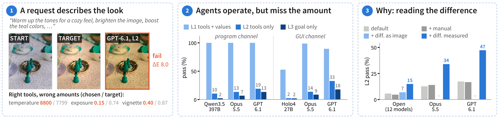

# GoldiBench: Right Tools, Wrong Amount

**Benchmarking agents on effect judgement in professional editing.**

[Project page](https://uservan.github.io/GoldiBench) · [Dataset](https://huggingface.co/datasets/VanWang/GoldiBench) ·
[All run logs](https://huggingface.co/datasets/VanWang/GoldiBench-logs)

<p align="center"></p>


Real editing requests describe a look, not the steps to reach it, so an agent must judge **how much** of each tool the
look takes. GoldiBench has **500 editing tasks in five professional applications** (darktable, RawTherapee, GIMP,
Inkscape, Blender). Each task pairs a START image with a TARGET rendered from a hidden program, so the amount has an exact
answer. The agent edits either by **writing a program** (program channel) or by **operating the application's GUI**
(GUI channel); its result is re-rendered and compared with TARGET. Every task is posed at three levels:

| level | the agent gets | measures |
|---|---|---|
| L1 | the tools **and** their values | operation |
| L2 | START, TARGET and the tools (no values) | effect judgement |
| L3 | START and TARGET only | tool choice + effect judgement |

**Pass rule.** `closeness = 1 - ΔE(result, TARGET) / ΔE(START, TARGET)` (mean CIEDE2000 at ≤1024 px);
a result passes when `closeness ≥ 0.75` **and** `ΔE ≤ 4`. Half-strength and double-strength edits fail; ×0.9 and ×1.1 pass
(checked for every task, `goldibench/bench/verify_b1.py`).

---

## 1. Install

Linux x86_64, Python ≥ 3.12, [uv](https://docs.astral.sh/uv/). Everything installs under your user, no root needed.

```bash
git clone https://github.com/uservan/GoldiBench && cd GoldiBench
uv sync --extra gui --extra paper           # Python deps (--extra gui: GUI agents; --extra closed: closed-model clients)
export VE_LOCAL=$HOME/.cache/goldibench     # where apps / tools / envs go (use a fast local disk)

bash scripts/setup_darktable.sh             # darktable 5.6.2   (pinned AppImages, sha256-checked)
bash scripts/setup_apps.sh                  # RawTherapee 5.13, GIMP 3.2.6, Inkscape 1.4.4, Blender 4.5.15
bash scripts/setup_gui.sh                   # GUI channel only: X tools (Xvfb, xdotool, openbox) + OSWorld agents (pinned commit)
bash scripts/setup_env.sh                   # optional: the exact vLLM env of the paper (env/vllm_env.lock.txt)
bash scripts/setup_opencua_env.sh           # optional: OpenCUA needs its own vLLM 0.12 env
```

## 2. Get the data

```bash
bash scripts/download_data.sh               # -> ./data (or set GOLDIBENCH_DATA); ~7 GB as a few tar archives
```

`data/bench_b1_<app>/` holds the program-channel tasks, `data/bench_b1_<app>_gui/` the GUI tasks; runs are written to
`data/bench_b1_<app>[_gui]/runs/<run>/`. See [docs/data.md](docs/data.md) for every file.

## 3. Add a model

Copy `configs/models.example.yaml` to `configs/models.yaml`. Any OpenAI-compatible chat endpoint with image input works:

```yaml
program:
  mymodel: {base_url: http://localhost:8000/v1, model: Qwen3.5-27B}
  gpt:     {base_url: https://api.openai.com/v1, model: gpt-4o, api_key_env: OPENAI_API_KEY}
gui:
  myagent: {kind: holo, port: 8011, model: Holo4-35B-A3B-FP8}
```

Open models: `scripts/serve_vllm.sh <hf_repo_or_dir> <served_name> <port> <gpus> [flags]` (paper settings: 64k context,
8 images; the per-model flags of the paper, e.g. reasoning and tool-call parsers, are in
[docs/conditions.md](docs/conditions.md)).

Closed models: the program channel takes any OpenAI-compatible endpoint (`base_url`, `model`, `api_key_env` as above);
the agent asks for `json_schema` structured output. The paper ran Claude Opus 5.5 and GPT-6.1 through Amazon Bedrock with
`goldibench/bench/bedrock_proxy.py` (an OpenAI-compatible proxy that also writes a per-call cost ledger; needs AWS
credentials, `uv sync --extra closed`). On the GUI channel Claude runs OSWorld's computer-use agent (Anthropic API by
default, `GOLDIBENCH_ANTHROPIC_PROVIDER=bedrock` for Bedrock) and GPT runs OSWorld's PromptAgent.
Pre-release tests ([docs/smoke_results.md](docs/smoke_results.md)) ran every path of this release: both channels on
all five applications, every GUI agent adapter (Holo, UI-TARS, UI-TARS-1.5, OpenCUA, Qwen, GUI-Owl, EvoCUA, Claude
computer use, PromptAgent) and the closed models through Amazon Bedrock.
The paper's model names (`qwen35`, `holo4_35b`, `uitars_7b`, ...) are built in; see
`goldibench/bench/run_agent.py` and `goldibench/gui/osworld_agents.py`.

## 4. Run

**Program channel** (the agent writes `{tool: {field: value}}` programs, sees each render, revises; 4 rounds):
```bash
export BENCH_APP=gimp BENCH_SET=bench_b1_gimp
python goldibench/bench/run_agent.py --models mymodel --levels L1 L2 L3 --run myrun --rounds 4 --max-tokens 32000
python goldibench/bench/score.py --run myrun          # -> data/bench_b1_gimp/runs/myrun/scores.json + summary table
```

**GUI channel** (OSWorld-style: screenshot → action, 100 steps; one virtual desktop per episode):
```bash
source scripts/xtools_env.sh
BENCH_APP=gimp python goldibench/gui/run_gui_osworld.py --models myagent --levels L1 L2 L3 --run myrun --max-steps 100
BENCH_APP=gimp python goldibench/gui/score_gui.py --run myrun
```
Episodes are resumable: rerunning a command skips finished episodes.

**Interventions of the paper** (program channel, L2): `--manual` (application manual as a skill), `--knowledge
table_state_diff` (measured TARGET−START difference), `--knowledge diff_image`, `--minimanual visual|text`,
`--feedback numeric`, `--forced`. The exact flags of every paper run are in [docs/conditions.md](docs/conditions.md).

## 5. Smoke test

```bash
GOLDIBENCH_DATA=./data MODEL=mymodel GUI_MODEL=myagent tests/smoke.sh   # 5 apps × 1 task (program) + 1 GUI episode
```

## 6. Reproduce the paper's tables and figures

All raw episodes of the paper (every model output, program, GUI action, screenshot, score, and the cost ledger of the
closed models) are in [VanWang/GoldiBench-logs](https://huggingface.co/datasets/VanWang/GoldiBench-logs). Restore them
into the original run layout and run the paper scripts:
```bash
bash scripts/download_data.sh                      # the benchmark (GOLDIBENCH_DATA)
bash scripts/restore_runs.sh                       # every run of the paper from the logs dataset (raw records only)
GOLDIBENCH_PAPER=./paper_out python goldibench/paper/main_tables.py   # -> paper_out/tab/main_prog.tex, main_gui.tex, ...
```
Checked before release: the regenerated main tables are identical to the paper's (program 42/42, GUI 75/75 entries,
per-application tables 210/210 and 375/375; the LaTeX rows match line by line). Other scripts: `main_ci.py` (95% CIs),
`ch5_numbers.py` (Sec. 5), `threshold_sweep.py`, `fig_*.py` (figures).

The logs are organised as `<channel>/<app>/<model>/<condition>/seed<k>/`, so download only what you need:
```bash
scripts/download_logs.sh --tables-only                                    # all tables, runs.csv, costs (small)
scripts/download_logs.sh --channel gui --app gimp --model gpt61gui        # one model on one app, with screenshots
```
or `load_dataset("VanWang/GoldiBench-logs", "episodes_paper")` (configs listed on the dataset page).

## 7. Building the benchmark (optional)

`goldibench/bench/gen_b1.py` generates candidate tasks (an open model proposes a professional edit, the program is rendered),
`verify_b1.py` checks every task (oracle replay, ×0.5/×0.9/×1.1/×2 strength, single-tool removal), `report_b1.py` and
`freeze_b1.py` freeze the approved set (`FROZEN` holds the sha256 of every program; runs refuse unfrozen or changed tasks).
`bedrock_proxy.py` is the OpenAI-compatible proxy used for the closed models, with a per-call cost ledger.

## Layout

```
goldibench/bench/   program channel: ops_<app>.py (tools, ranges, renderer), run_agent.py, score.py, interventions
                    (manual.py, knowledge.py, minimanual.py), generation and verification (gen_b1, verify_b1, freeze_b1)
goldibench/gui/     GUI channel: per-app desktop envs (env.py darktable, gimp_env.py, app_envs.py), OSWorld agent adapters
                    (osworld_agents.py), runner (run_gui_osworld.py), scorer (score_gui.py), GUI task builders
goldibench/paper/   tables and figures of the paper
scripts/            installers, vLLM server, data download
configs/            model lists (models.example.yaml, smoke.yaml)
env/                exact lock file of the vLLM environment used in the paper
docs/               data.md (every file of the dataset and the logs), conditions.md (paper runs → flags), gui.md
tests/              smoke.sh
```

## License

Code: Apache-2.0. Data: CC-BY-4.0; source images keep their own licenses (PSBench, Poly Haven CC0, Openclipart public domain).

## Citation

```bibtex
@misc{yang2026goldibench,
  title  = {GoldiBench: Right Tools, Wrong Amount -- Benchmarking Agents on Effect Judgement in Professional Editing},
  author = {Yang, Wang and Li, Xinpeng and Zhang, Yanyan and Song, Chaoda and Wang, Shouren and Ganguly, Debargha and
            Singh, Vikash and Ma, Chuang and Cai, Xiaoran and Ye, Kai and Han, Xiaotian and Chaudhary, Vipin},
  year   = {2026}
}
```
